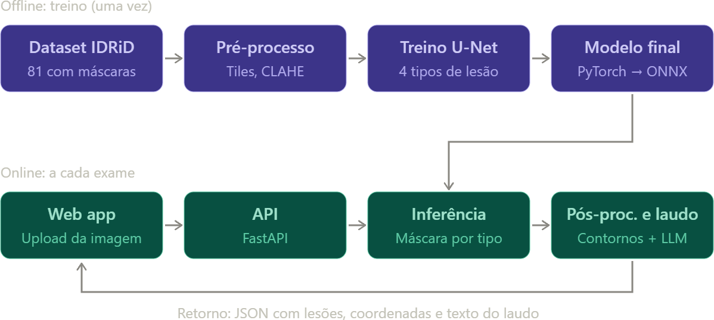

<div align="center">

# 👁️ retina-seg

**Segmentação de lesões de retinopatia diabética em imagens de fundo de olho — do pixel ao laudo.**


</div>

> ⚠️ **Aviso:** projeto pessoal/acadêmico. **Não é um dispositivo médico** e seus resultados
> **não substituem a avaliação de um oftalmologista**. Todo laudo gerado pela API inclui este aviso.

---

## ✨ Sobre

Upgrade de um TCC que usava uma CNN (Keras) para classificar imagens com/sem retinopatia diabética.
Agora o projeto **localiza e tipifica cada lesão** na imagem, em vez de só dizer "tem / não tem":

| Sigla | Lesão |
|:-----:|-------|
| **MA** | Microaneurismas |
| **HE** | Hemorragias |
| **EX** | Exsudatos duros |
| **SE** | Exsudatos moles (*soft exudates*) |

Para cada lesão detectada, a API devolve tipo, centro, raio, área, score e quadrante — tudo em
**resolução original** — além de um grau de severidade (inspirado na escala ICDR) e um laudo em texto.

## 🧭 Pipeline



1. **Offline (uma vez):** IDRiD → pré-processamento (recorte do círculo da retina, CLAHE, tiles
   512×512) → treino de uma U-Net → export para ONNX.
2. **Online (a cada exame):** upload → API FastAPI → inferência por janela deslizante →
   pós-processamento (componentes conectados) → JSON com lesões, grau e laudo.

## 🧠 Decisões técnicas

- **Dataset:** [IDRiD](https://ieee-dataport.org/open-access/indian-diabetic-retinopathy-image-dataset-idrid)
  — "A. Segmentation": 81 imagens ~4288×2848 (54 treino / 27 teste) com máscaras por tipo de lesão.
- **Sem redimensionar a imagem inteira:** microaneurismas somem em baixa resolução, então o treino
  usa tiles 512×512 com 25% de sobreposição.
- **Modelo:** `smp.Unet` com encoder `efficientnet-b3` (ImageNet), 4 canais de saída com sigmoid.
- **Loss:** Dice + BCE. **Treino** com AMP, batch 8 (fallback 4 + gradient accumulation) — cabe em 8 GB de VRAM.
- **Validação rigorosa:** 8 imagens separadas do treino oficial; o conjunto de teste (27 imagens)
  é usado **somente** na avaliação final.
- **Métricas:** AUPR por lesão (métrica oficial do IDRiD) e Dice.
- **Inferência:** janela deslizante com média nas sobreposições e remontagem na resolução original.
- **Grau:** regras heurísticas derivadas das lesões (aprox. ICDR). Sem detecção de neovascularização,
  o grau máximo atingível é 3 (RDNP grave).
- **Laudo:** template fixo determinístico, sempre com o aviso obrigatório. Ponto de integração com
  LLM já documentado em `src/api/report.py`.

## 📊 Resultados

Melhor checkpoint (época 15 de 30) na validação:

| Métrica | Valor |
|---------|:-----:|
| Dice médio (MA / HE / EX / SE) | **0.613** |

Como sanity check, o pipeline completo foi rodado numa imagem do conjunto de teste
(`IDRiD_55`, nunca vista em treino/validação) e comparado visualmente com o ground truth: formato e
distribuição espacial de MA/HE/EX praticamente idênticos. A avaliação final (AUPR no conjunto de teste
completo) ainda está pendente.

## 🚀 Começando

**Requisitos:** Python 3.12, [uv](https://docs.astral.sh/uv/) e, de preferência, uma GPU NVIDIA.

```bash
git clone <url-do-repo> && cd retina-seg
uv sync                        # instala dependências
uv run python check.py         # valida GPU + forward pass do modelo
```

### Dataset

O bucket oficial do IEEE DataPort não permite acesso anônimo; o script usa um espelho no Kaggle
(requer credenciais do Kaggle configuradas):

```bash
uv run python download-kaggle.py   # baixa para data/raw/idrid/
```

### Pré-processar, treinar, inferir

```bash
uv run python -m src.preprocess                         # tiles 512x512 em data/processed/
uv run python -m src.train --epochs 30                  # treino (use --quick para um smoke test)
uv run python -m src.infer <imagem> --export-onnx models/model.onnx
```

> Os pesos (`models/`) e o dataset (`data/`) são git-ignored e nunca versionados.

### API

```bash
uv run uvicorn src.api.main:app --reload
```

```bash
curl -F "file=@IDRiD_55.jpg" http://localhost:8000/analyze
```

Resposta (resumida):

```json
{
  "image": { "width": 4288, "height": 2848 },
  "grade": { "value": 3, "label": "..." },
  "lesions": [
    { "type": "EX", "cx": 1820, "cy": 1344, "r": 9, "area": 254, "score": 0.91, "quadrant": "..." }
  ],
  "summary": { "MA": 69, "HE": 29, "EX": 467, "SE": 0 },
  "report": "Texto do laudo... não substitui avaliação oftalmológica."
}
```

### Testes

```bash
uv run pytest
```

Testes que dependem de dataset/checkpoint são pulados automaticamente quando eles não existem.

## 🗂️ Estrutura

```
src/
  config.py        # configuração centralizada (sem números mágicos)
  preprocess.py    # recorte da retina, CLAHE, tiling
  dataset.py       # Dataset PyTorch + augmentations (albumentations)
  train.py         # treino, AMP, métricas, checkpoints
  infer.py         # janela deslizante, remontagem, export ONNX
  postprocess.py   # máscara -> lesões (OpenCV), regras de grau
  api/             # FastAPI: main, schemas, report
tests/             # pytest (pré/pós-processamento, API, laudo)
docs/              # ROADMAP.md e diagrama do pipeline
data/  models/     # dataset e pesos (git-ignored)
```

## 🛣️ Roadmap

- [x] Dataset IDRiD e pré-processamento
- [x] Dataset PyTorch + augmentations
- [x] Treino da U-Net (EfficientNet-B3)
- [x] Inferência, pós-processamento e export ONNX
- [x] API `POST /analyze` com laudo por template
- [ ] Front web em React (overlay SVG com lesões circuladas, toggle por tipo, laudo)
- [ ] Avaliação final no conjunto de teste (AUPR por lesão)
- [ ] Laudo via LLM (com template como fallback)
- [ ] Classificador de grau dedicado

Detalhes em [`docs/ROADMAP.md`](docs/ROADMAP.md).

## 🙏 Créditos

- Dataset: Porwal et al., *Indian Diabetic Retinopathy Image Dataset (IDRiD)*, IEEE DataPort.
- [segmentation-models-pytorch](https://github.com/qubvel-org/segmentation_models.pytorch) e
  [albumentations](https://albumentations.ai/).

---

<div align="center">
Feito por <a href="https://github.com/demmorou">demmorou</a> · Projeto acadêmico, não clínico
</div>
